# General information

- Name of the challenge: i_love_spaghetti

- Download date: March 17th 2026 09h54
- Resolved: Yes

- Solution (Password): Ha22Y_H4rR1s0n
- Finish date: March 22nd 2026 18h14
- Time spent: 0day 04h 00min

- Tools used: ghidra

# Resolution steps

I have launched the program.

I have tried clef as argv and I have seen that it's not the right key

I have opened the program in ghidra

I have opened the entry function then jumped to the main

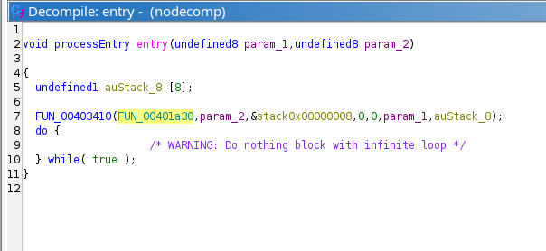

I saw these instructions and decided to check them out : 

- uVar2 = FUN_00401c60(param_2[1]);
- and this one: iVar1 = FUN_00401fc0(&DAT_0049903c,uVar2); 
- and decided to check out the functions that are called and whatever is stored in this address 0049903c

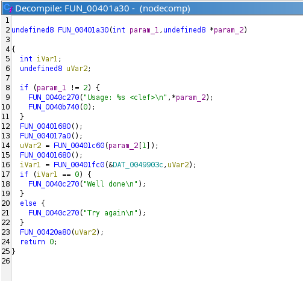

FUN_00401c60 : It calls this function FUN_00401c80(param_1 + -10) 

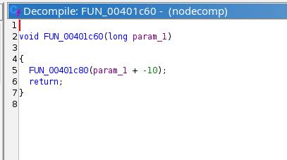
 

FUN_00401c80 :
this function calls FUN_00401b20(param_1 + 1) which calls FUN_00401b40(param_1 + -9) which calls FUN_00401ae0(param_1 + 2); which calls FUN_00401b00(param_1 + -8); which calls FUN_00401be0(param_1 + 3); which calls :FUN_00401c00(param_1 + -7); which also calls FUN_00401d40(param_1 + 4); which calls FUN_00401d00(param_1 + -6);which calls FUN_00401cc0(param_1 + 5); which calls FUN_00401ce0(param_1 + -5); which calls FUN_00401d60(param_1 + 6);which calls FUN_00401b60(param_1 + -4);which calls FUN_00401b80(param_1 + 7); ........ until the function  FUN_00401bc0 that calls FUN_00401910(param_1); which calls thunk_FUN_00422e70();

the sum of all the offsets in the chain starting from FUN_00401c60 : -10+1-9+2-8+3-7+4-6+5-5+6-4+7-3+8-2+9-1+10 = 0

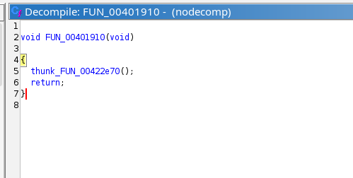

**image of thunk_FUN_00422e70**

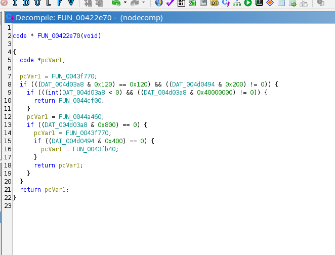

this function does the following : 
it detects CPU features at runtime and selects the fastest available strcmp implementation (SSE4.2 vectorised, AVX, or plain).

 
same thing happened with  FUN_00401fc0 which led to the function FUN_00401820

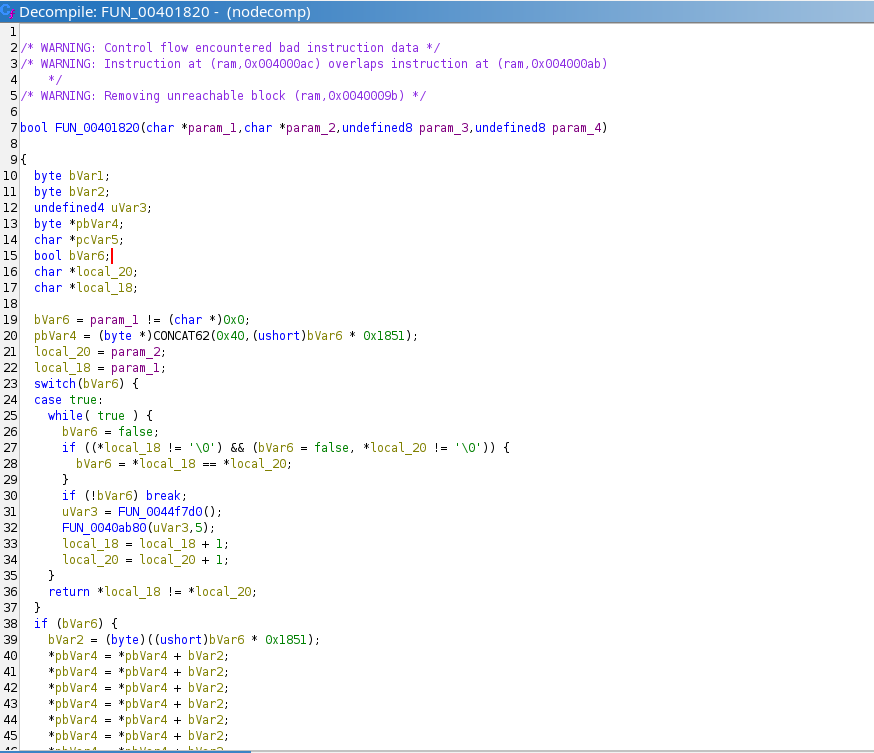

this function FUN_00401820 :

The real logic of this function is just a simple string comparison loop at the top .

the massive block of memory writes at the bottom is unreachable dead code . the switch(bVar6) with case true always returns before reaching it. Worth one sentence so a reader does not spend time analysing that block.

DAT_0049903c : 0049903c
The target string starting at 0x49903c is 14 bytes long (including the null terminator). The bytes 0a 42 cd fe 1b 7c b7 f8 30 71 ce bf 72 4d are all non-printable so the input must be transformed before comparison :

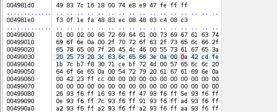

I noticed that FUN_00401910 was the last function in the chain before strcmp but Ghidra's decompiler showed no return , the function uses PUSH + JMP instead of a normal CALL 

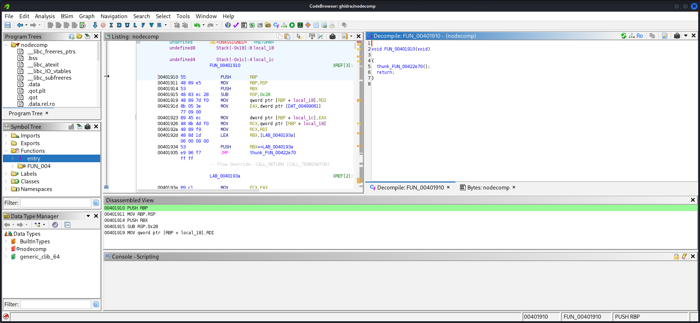 

To see the real code, I used objdump :

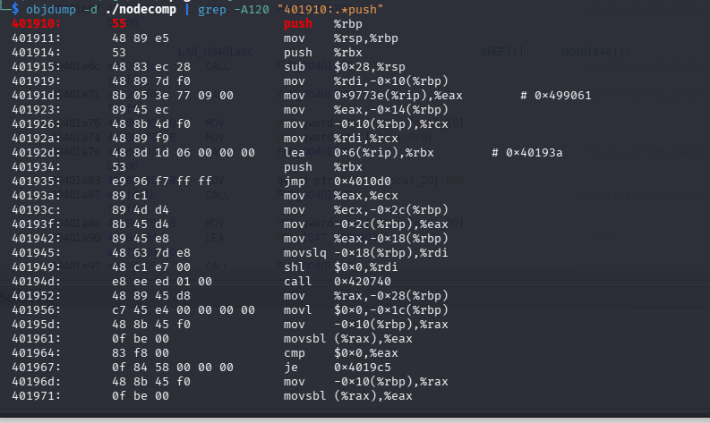
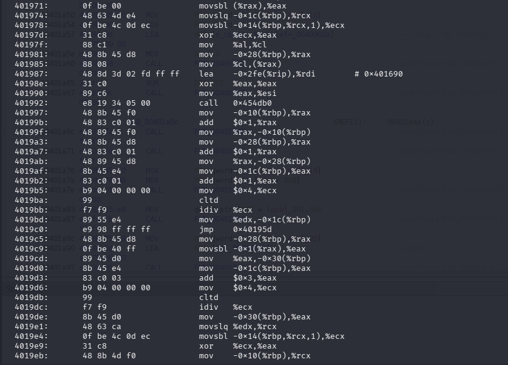
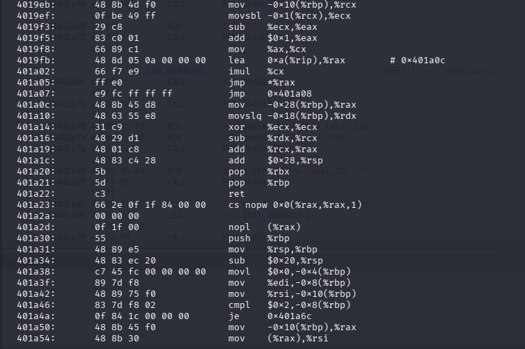
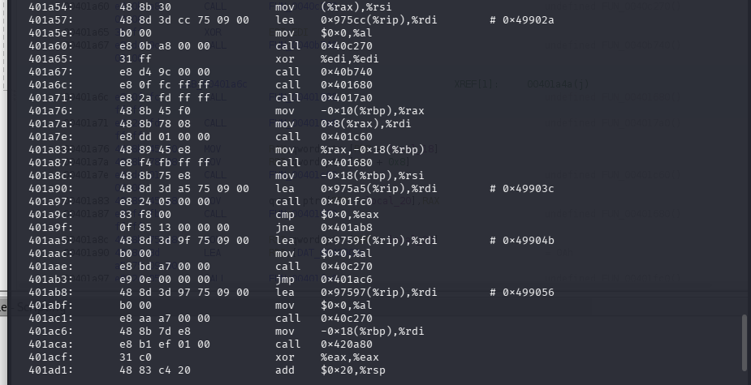

**Step A : Load the 4-byte key onto the stack**

40191d:  mov 0x9773e(%rip),%eax    # reads 4 bytes from address 0x499061

401923:  mov %eax,-0x14(%rbp)      # stores key on stack

The instruction at 0x40191d reads 4 bytes from address 0x499061 into the eax register, then stores them on the stack. 0x499061 contains: 42 23 ff cc. These are the XOR key bytes.

**Step B : Allocate output buffer**

401942:  mov -0x18(%rbp),%eax      # strlen result (length of input)

401945:  movslq -0x18(%rbp),%rdi

40194d:  call 0x420740             # malloc(strlen(input))

401952:  mov %rax,-0x28(%rbp)      # store output buffer pointer

The function allocates a new buffer the same size as the input to store the encoded output.

**Step C : The XOR encoding loop**

40195d:  mov -0x10(%rbp),%rax      # rax = input pointer

401961:  movsbl (%rax),%eax        # eax = *input (load current char)

401964:  cmp $0x0,%eax            

401967:  je 0x4019c5              # if null terminator, exit loop

401974:  movslq -0x1c(%rbp),%rcx  # rcx = i (loop index)

401978:  movsbl -0x14(%rbp,%rcx,1),%ecx  # ecx = key[i]  <-- KEY BYTE

40197d:  xor %ecx,%eax            # eax = input[i] XOR key[i]  <-- XOR!

40197f:  mov %al,%cl

401985:  mov %cl,(%rax)           # output[i] = encoded byte

40199b:  add $0x1,%rax            # input++

4019af:  mov -0x1c(%rbp),%eax     # eax = i

4019b2:  add $0x1,%eax            # i++

4019b5:  mov $0x4,%ecx

4019bb:  idiv %ecx               # i = i % 4  (wrap key index at 4)

4019c0:  jmp 0x40195d            # loop back

- This is the complete encoding algorithm: for each character in the input, XOR it with the key byte at position i mod 4. The key is 4 bytes long and repeats. The key index wraps every 4 characters using integer division by 4 and taking the remainder.

- Since A XOR B XOR B = A , we can recover the plaintext by XORing the encoded target bytes with the same key:
plaintext[i] = encoded_target[i] XOR key[i % 4]

i | Target | Key[i%4] | Result (hex) | Result (dec) | Character

0 | 0x0a | 0x42 (key[0]) | 0x48     |     72       |   H

1 | 0x42 | 0x23 (key[1]) | 0x61     |     97       |   a

2 | 0xcd | 0xff (key[2]) | 0x32     |     50       |   2

3 | 0xfe | 0xcc (key[3]) | 0x32     |     50       |   2

4 | 0x1b | 0x42 (key[0]) | 0x59     |     89       |   Y

5 | 0x7c | 0x23 (key[1]) | 0x5f     |     95       |  _

6 | 0xb7 | 0xff (key[2]) | 0x48     |     72       |  H

7 | 0xf8 | 0xcc (key[3]) | 0x34     |     52       |   4

8 | 0x30 | 0x42 (key[0]) | 0x72     |     114      |   r

9 | 0x71 | 0x23 (key[1]) | 0x52     |     82       |    R

10 | 0xce | 0xff (key[2]) | 0x31      |   49         |  1

11 | 0xbf | 0xcc (key[3]) | 0x73       |  115       |  s

12 | 0x72 | 0x42 (key[0]) | 0x30     |    48     |     0

13 | 0x4d | 0x23 (key[1]) | 0x6e     |    110    |     n

clef : Ha22Y_H4rR1s0n

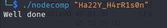

