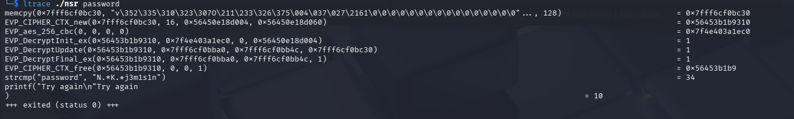
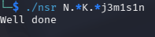

# General information

- Name of the challenge: no_strings_reloaded

- Download date: March 22nd 2026 10h21
- Resolved: Yes

- Solution (Password): N.*K.*j3m1s1n
- Finish date: March 22nd 2026 10h34
- Time spent: 0day 00h 13min

- Tools used: ltrace

# Resolution steps

I have launched the program.

I have try "password" as argv and I have seen that it's not the right password

I have ran this command : ltrace ./nsr password

in this line strcmp("password", "N.*K.*j3m1s1n")  
it compares  our input with N.*K.*j3m1s1n which should be the password . 

I tried it and it worked .
