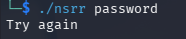
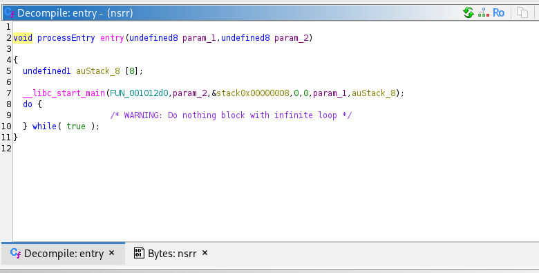
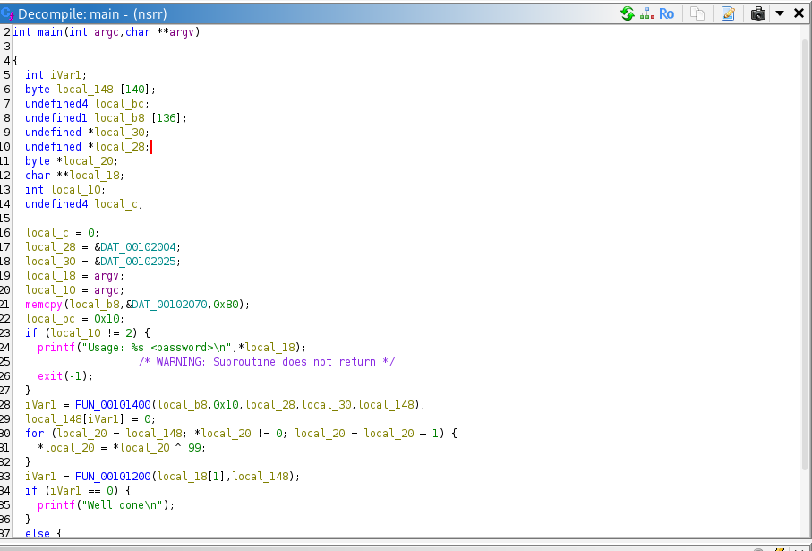
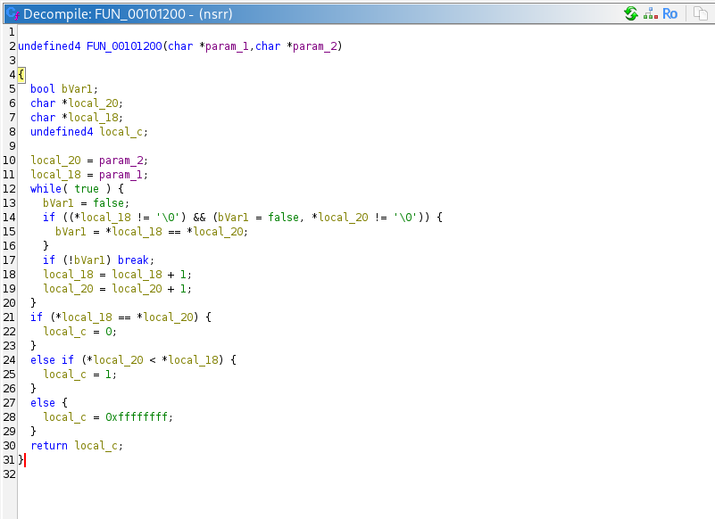
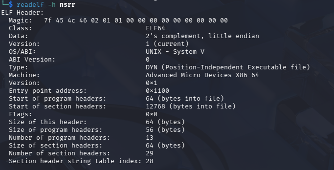
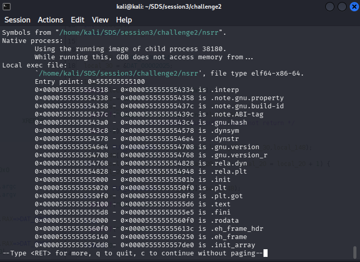
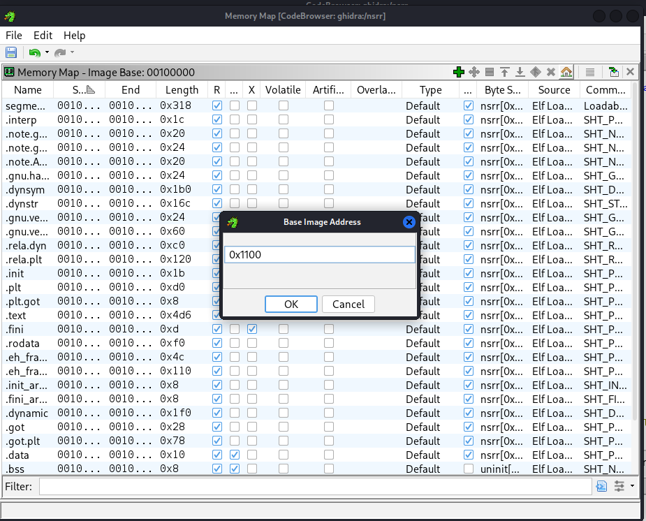
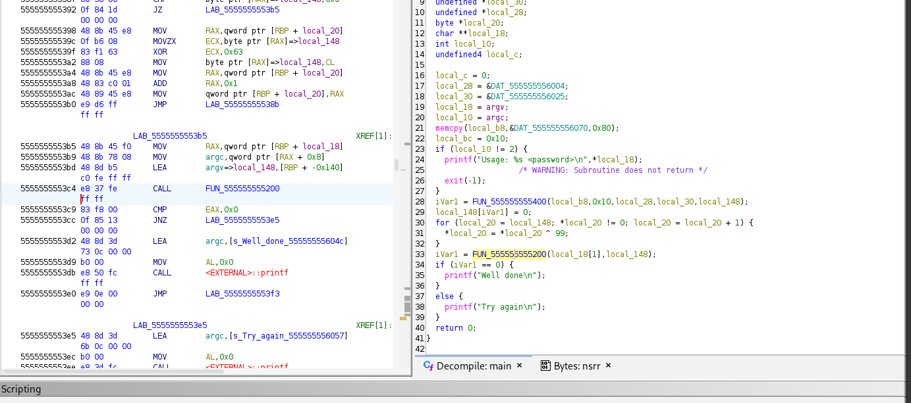
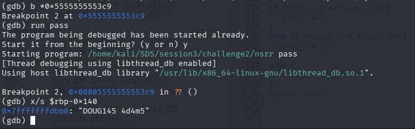

# General information

- Name of the challenge: no_strings_rereloaded

- Download date: March 22nd 2026 10h21
- Resolved: Yes/No

- Solution (Password): DOUG145 4d4m5
- Finish date: January 1st 2022 00h00
- Time spent: 0day 00h 00min

- Tools used: ghidra , gdb

# Resolution steps

I have launched the program.

I have tried "password" as argv and I have seen that it's not the right password

I have opened the program in ghidra

I have opened the entry function

and then went to the main function 

inside the main :
local_18 = argv;  : local_18 takes the value of our input 

iVar1 = FUN_00101200(local_18[1],local_148); : this ivar1 takes the value of the return of the function call and then it does the comparison 
  if (iVar1 == 0) {
    printf("Well done\n");
  } : if ivar1 is 0 then it's the correct password . 
so i decided to check out the function FUN_00101200 

The function performs a manual string comparison by iterating through both input strings simultaneously using two pointers. It moves through the characters as long as they are identical and neither string has reached its null terminator (\0). Once a mismatch or the end of a string is encountered, the loop breaks, and the function compares the ASCII values of the current characters: it returns 0 if the strings are identical, 1 if the first string is lexicographically "greater," and -1 (0xffffffff) if it is "smaller

so I need to know what local_148 value is . It should have the correct password .
It's passed as an argument to the comparison function .

by running readelf -h nsrr : 
i found out that the entry point is Entry point: 0x1100

by running file info in gdb : 
i found out that the entry point is Entry point: 0x555555555100

0x555555555100 - 0x1100 = 0x555555554000
so i went to ghidra memory map to rebase to the address 0x555555554000

I went back to my main function : 

in the listing view we can see :
5555555553c4    CALL    FUN_555555555400        # calls the comparison function that takes local_148 as arg
5555555553c9    CMP     EAX, 0x0                # first instruction after the call returns

instruction break at b *0x5555555553c9
run pass
x/s $rbp-0x140
DOUG145 4d4m5

