# General information

- Name of the challenge: no_strings_rerereloaded

- Download date: March 22nd 2026 10h21
- Resolved: No

- Solution (Password): XXX
- Finish date: January 1st 2022 00h00
- Time spent: 0day 00h 00min

- Tools used: ghidra , pwndgb 

# Resolution steps

I have launched the program.

I have try "password" as argv and I have seen that it's not the right password

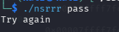

I have open the program in ghidra

I went to the entry function 

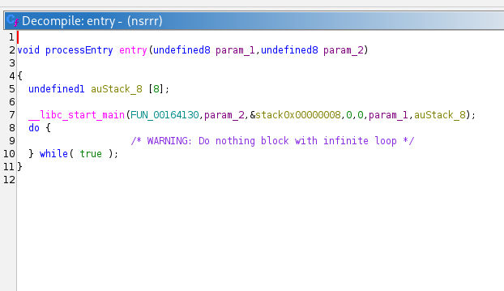

went to the main function : 

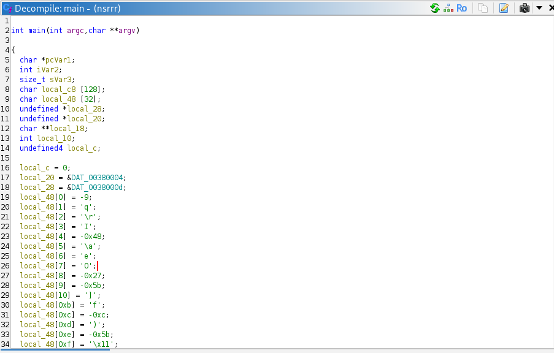

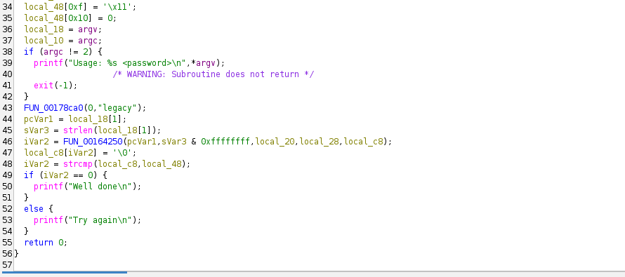

in line 36 there was this instruction local_18 = argv;

and this line : (iVar2 == 0) 

this condition has to be true in order to print "well done" so I need to know when does ivar2 = 0 ?

just before it there is this instruction : iVar2 = strcmp(local_c8,local_48);

in order for ivar2 to be 0 local_c8 and local_48 need to be equal . 

local_c8 : It was passed as the last parameter in this function call inside the main : iVar2 = FUN_00164250(pcVar1,sVar3 & 0xffffffff,local_20,local_28,local_c8);

as well as pcVar1 = local_18[1]; which is our input and  sVar3 = strlen(local_18[1]); which is the length of out input . So i decided to check this function FUN_00164250

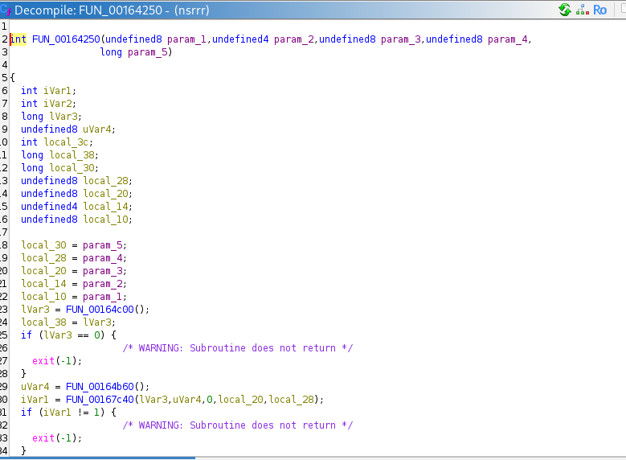
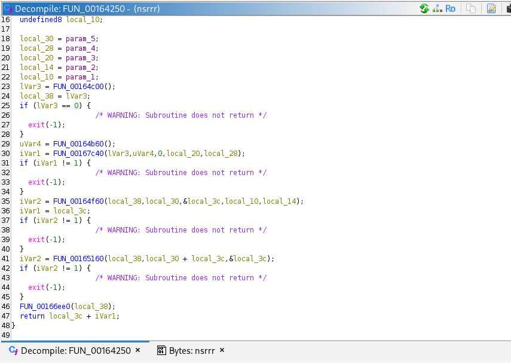

Inside this function there multiple function calls :

1 FUN_5555555b8c00() : which in turn calls FUN_5555555c8d90() which is a memory allocator .

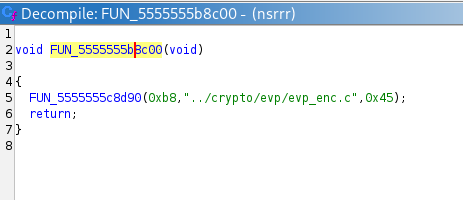
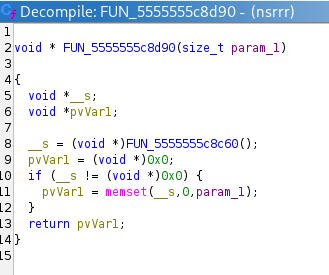

2 FUN_5555555b8b60() : returns &DAT_5555558cfc20 which contains the value 31 

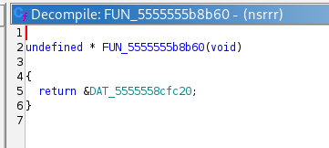
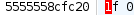

3 FUN_5555555bbc40() : calls  FUN_5555555bbc20() which calls : FUN_5555555bb2c0

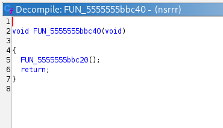
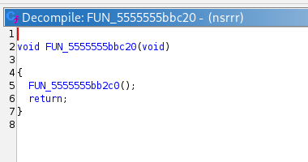

FUN_5555555bb2c0 : This seems like an implementation of an OpenSSL encryption function . 

I needed to rebase my memory in order to see the value of registers through the execution .

real entry point : 0x64040

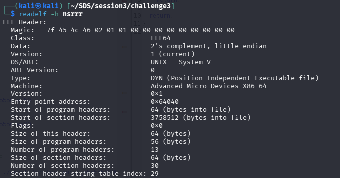

 
the gdb entry point address : 0x5555555b8040 

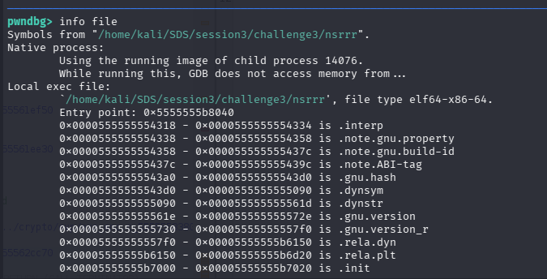

ghidra address to rebase to : 0x5555555b8040 - 0x64040

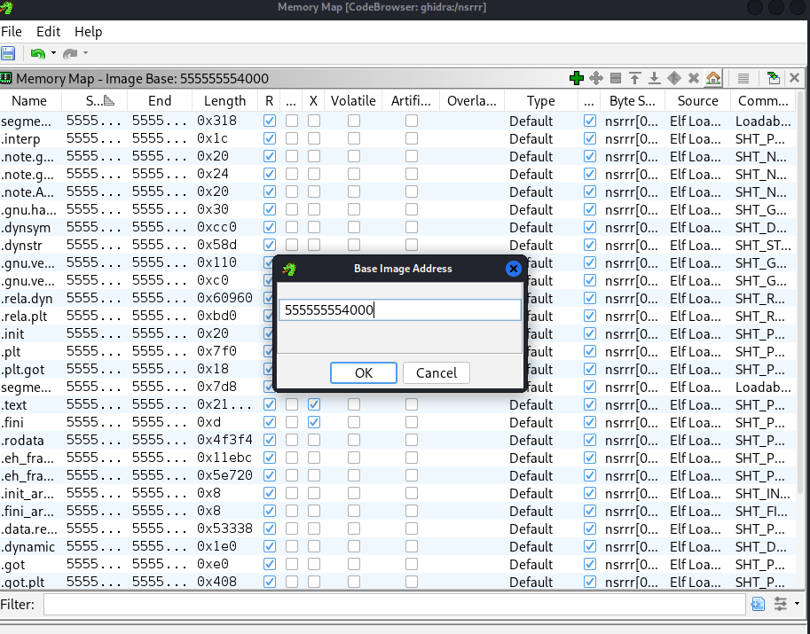

I decided to check the contents of rdi and rsi after setting a breakpoint at the address of the comparison instruction iVar2 = strcmp(local_c8,local_48) which is 5555555b8210 

rsi : 

always the same : 

0xf7  0x71  0x0d  0x49  0xb8  0x07  0x65  0x4f

0xd9  0xa5  0x5d  0x66  0xf4  0x29  0xa5  0x11

$rdi — changed every run :

Run 1 — input "password":

0xd2  0x2d  0xf3  0xcd  0xfd  0x3d  0x0d  0xff

0xdb  0x67  0x91  0x1a  0xda  0xcb  0x82  0x30

Run 2 — input "AAAAAAAAAAAAAAAA":

0x13  0xfa  0xff  0xc4  0xfc  0x8e  0xb2  0x4f

0x79  0x1a  0x9a  0x69  0xd6  0xc5  0xd5  0xfb