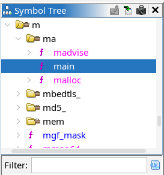
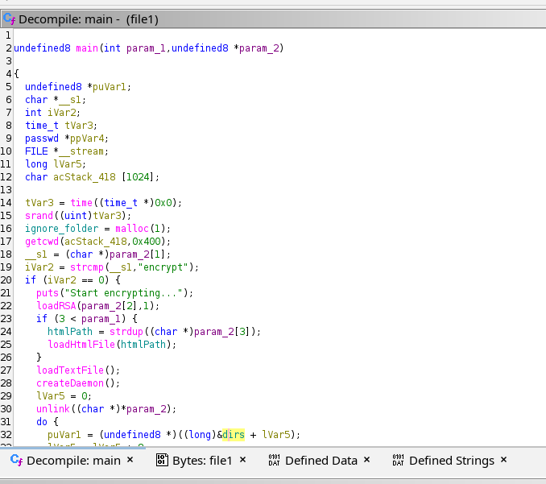
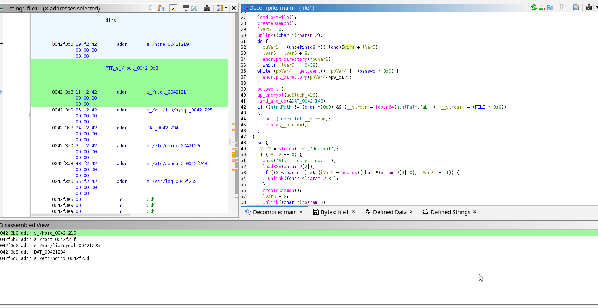
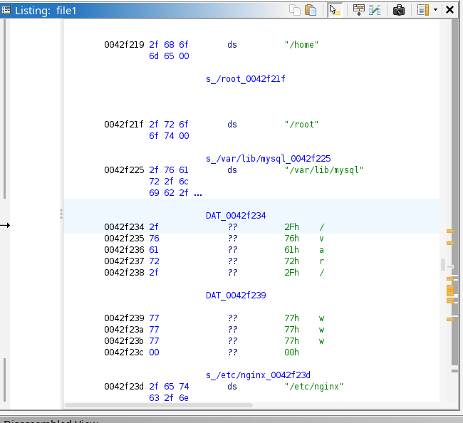

# General information

- Name of the challenge: ransomware

- Download date: January 1st 2022 00h00
- Resolved: Yes/No

- Solution (Password): /home,/root,/var/lib/mysql,/var/www,/etc/nginx,/etc/apache2,/var/log
- Finish date: January 1st 2022 00h00
- Time spent: 0day 00h 00min

- Tools used: ghidra

# Resolution steps

I have opened the program in ghidra . 

thankfully the functions are alphabetically ordered , so I opened the main function .

The main function is calling the function encrypt directory and passing the variable puVar1 .

by clicking one this variable and looking at the listing view we can see a list of directories :

/home,/root,/var/lib/mysql, 

and then DAT_0042f234 : 

/var/www,

/etc/nginx,/etc/apache2,/var/log

the answer is : /home,/root,/var/lib/mysql,/var/www,/etc/nginx,/etc/apache2,/var/log

...
